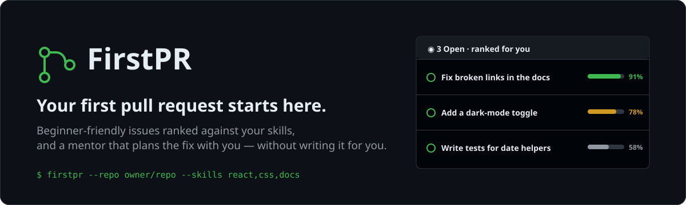
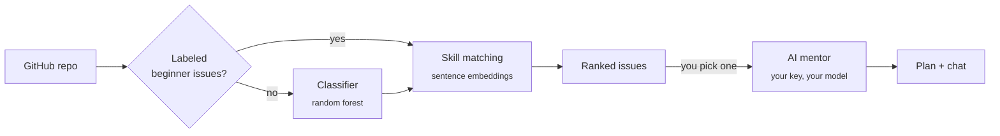

<div align="center">

<a href="https://first-pr-mauve.vercel.app"></a>

<p>
  <a href="https://first-pr-mauve.vercel.app"></a>
  <a href="https://huggingface.co/spaces/confusedguy/firstpr-backend"></a>
</p>
<p>
  
  
  
  
</p>

**[Open the app](https://first-pr-mauve.vercel.app/app)** · **[Try it on an example repo](https://first-pr-mauve.vercel.app/app?repo=https%3A%2F%2Fgithub.com%2Flingdojo%2Fkana-dojo)** · **[How it works](#how-it-works)** · **[Run it locally](#run-it-locally)**

</div>

---

Wanting to contribute to open source is easy. Knowing **which issue to pick** and **where to even start** is the hard part.

**FirstPR** points at any public GitHub repository, finds the beginner-friendly issues, ranks them against the skills *you* already have, and turns the one you pick into a step-by-step plan, with a mentor you can ask when you're stuck. It never writes the code for you: the pull request stays yours.

## ✨ What you get

| | |
| --- | --- |
| 🔎 **Issues that fit you** | Labeled newcomer issues first (`good first issue`, `help wanted`, `documentation`…), with a trained classifier as a fallback when a repo doesn't label them. |
| 🎯 **A fit score for every issue** | Your skills are expanded into related terms and compared with each issue using sentence embeddings, so you start where you're strongest. |
| 🗺️ **A plan, not a patch** | Pick an issue and get a numbered checklist: set up, reproduce, where to look, what to test, what to write in the PR. |
| 💬 **A mentor on call** | Ask follow-up questions about any step. Answers stay focused on your issue and your repo. |
| 🔑 **Bring your own AI** | Use your key from OpenAI, Anthropic, Gemini, OpenRouter, Groq and more. Finding issues needs no key at all. |
| 🛡️ **Private by design** | Read-only GitHub access, keys never stored on the server, and a strict Content-Security-Policy in the browser. |

## 🚀 How it works

1. **Point it at a repo.** Paste any public GitHub URL and add the skills you're comfortable with: languages, frameworks, tools.
2. **Pick an issue.** FirstPR ranks the beginner-friendly issues by how well they fit you. Filter by label, or paste a specific issue.
3. **Follow your plan.** Tick off tasks as you go, ask the mentor when you're stuck, then open your pull request on GitHub.



## 🔑 Bring your own key

The mentor runs on **your own API key**. Open **Connect AI** in the app, pick a provider, paste a key, and choose a model from the provider's live list. The model list loads automatically, and there's a **Test connection** button.

| Provider | Get a key | Notes |
| --- | --- | --- |
| Google Gemini | [aistudio.google.com/apikey](https://aistudio.google.com/apikey) | Free tier |
| Groq | [console.groq.com/keys](https://console.groq.com/keys) | Very fast, free tier |
| OpenRouter | [openrouter.ai/settings/keys](https://openrouter.ai/settings/keys) | One key, many models |
| OpenAI | [platform.openai.com/api-keys](https://platform.openai.com/api-keys) | |
| Anthropic | [console.anthropic.com](https://console.anthropic.com/settings/keys) | |
| Mistral · DeepSeek · xAI | in each provider's console | |
| Custom | any OpenAI-compatible endpoint | Must be public `https` |

> [!TIP]
> Use a large general-purpose model, like a 70B-class or bigger open model or any frontier model. Small or special-purpose models (7B, guard, speech) give garbled plans, and the app warns you if you pick one.

**Where your key goes:** it's kept in your browser (or only for the current tab, if you untick *Remember*), sent over HTTPS with each mentor request to the backend, passed to your provider for that request, and never stored or logged on the server.

## 🧰 Tech stack

- **Frontend (this repo):** React 18, TypeScript (strict), Vite, `react-markdown`, deployed on Vercel. Styled after GitHub's dark theme (Primer colors, system fonts) with no UI framework.
- **Backend:** FastAPI on a [Hugging Face Space](https://huggingface.co/spaces/confusedguy/firstpr-backend), using PyGithub, scikit-learn (beginner-issue classifier), sentence-transformers (`all-MiniLM-L6-v2`) and a provider-agnostic LLM layer over plain HTTP.

## 💻 Run it locally

```bash
git clone https://github.com/SaurabhLingam/FirstPR-frontend.git
cd FirstPR-frontend
npm install
npm run dev            # http://localhost:5173 (landing) · /app (the app)
```

It talks to the deployed backend by default. To use something else, set `VITE_BACKEND_URL` (see `.env.example`):

```bash
# a backend running on your machine
VITE_BACKEND_URL=http://localhost:7860 npm run dev

# no backend at all: a mock with canned answers
npm run mock                                          # terminal 1
VITE_BACKEND_URL=http://localhost:7861 npm run dev    # terminal 2
```

> On Windows PowerShell, set the variable first: `$env:VITE_BACKEND_URL="http://localhost:7861"; npm run dev`

| Command | What it does |
| --- | --- |
| `npm run dev` | Dev server with hot reload |
| `npm run build` | Type-check and build to `dist/` |
| `npm run preview` | Serve the built `dist/` |
| `npm test` | Unit tests (URL, plan and error parsing, provider detection) |
| `npm run mock` | Fake backend on port 7861 |

<details>
<summary><b>Project structure</b></summary>

```
src/
  main.tsx             "/" → landing page, "/app" → the app
  App.tsx              app state, persistence, backend calls
  components/          Landing, Header, SetupView, ScanView, IssuesView, PlanView,
                       AISettingsDialog, HelpPanel, …
  lib/api.ts           fetch with timeouts, readable errors, Space wake-up polling
  lib/github.ts        repo/issue URL parsing
  lib/plan.ts          turns the mentor's numbered plan into checklist steps
  lib/providers.ts     AI provider presets, key-prefix hints, default-model picking
  lib/aiSettings.ts    the user's provider/key/model, stored in the browser
  lib/storage.ts       safe session/local storage
  data/skill_map.json  copy of the backend's skill map (keep in sync)
mock/server.mjs        offline stand-in for the backend
docs/banner.svg        the banner above
```
</details>

<details>
<summary><b>Deploying to Vercel</b></summary>

`vercel.json` tells Vercel to install with `npm ci`, build with `npm run build` and serve `dist/`. It also routes `/app` (and the old `/app.html`) to the app. To use a different backend, set `VITE_BACKEND_URL` under *Project → Settings → Environment Variables* and redeploy.

`vercel.json` also sets a **Content-Security-Policy** whose `connect-src` only allows `https://*.hf.space`. If the backend moves to another host, add it there too, or the browser will block the requests. The policy matters because AI keys live in the browser: it blocks third-party scripts and stops the page sending data anywhere but the backend.
</details>

<details>
<summary><b>Backend contract</b></summary>

- Every request sends the user's `skills`. Mentor requests (`/plan`, `/chat`) also send `X-LLM-Provider`, `X-LLM-Key`, `X-LLM-Model` and, for custom endpoints, `X-LLM-Base-URL`.
- `/recommend` returns structured `issues` (labels, fit scores, matched skills), plus the mentor's `message` when a key is set. It also works with older backends that return only a markdown `message`.
- Errors come back as `{"detail": "..."}`. A `401` opens the AI settings dialog.

See the [backend README](https://huggingface.co/spaces/confusedguy/firstpr-backend/blob/main/README.md) for the full API.
</details>

## 🤝 Contributing

Issues and pull requests are welcome, and yes, you can use FirstPR to find your first one here. 😄

1. Fork the repo and create a branch: `git checkout -b my-change`
2. Run `npm test` and `npm run build` before you push
3. Open a pull request that describes the change and links the issue it fixes

---

<div align="center">
<sub>Built for everyone who's ever stared at a repo wondering where to start.</sub>
</div>
